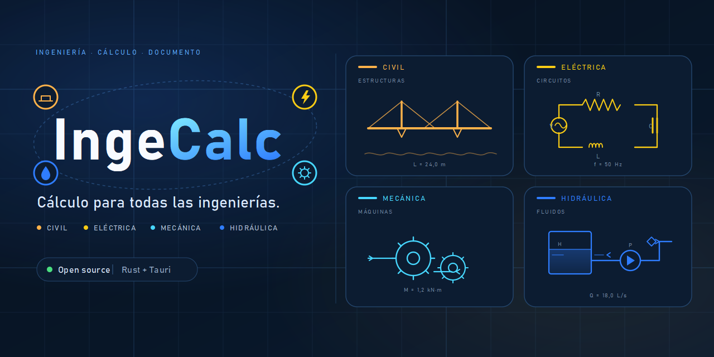
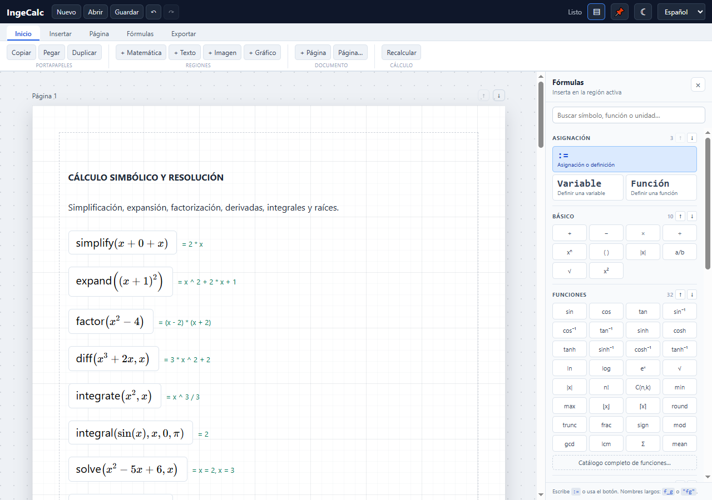
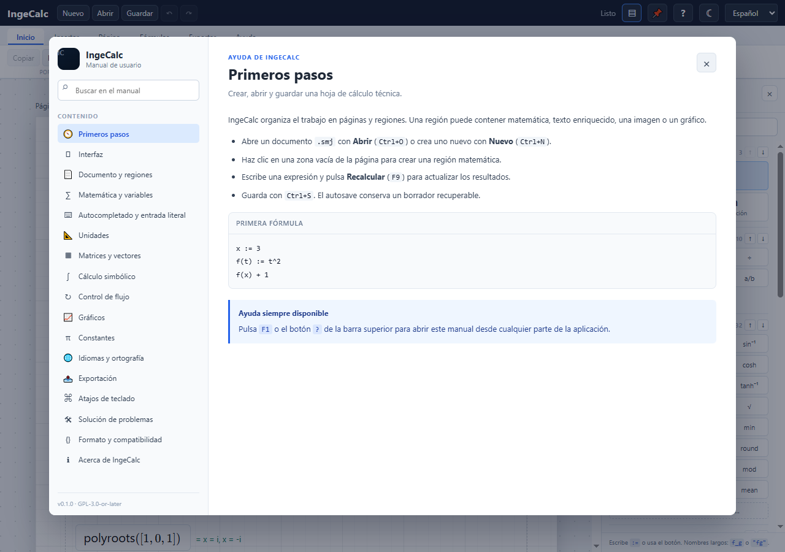

<p align="center">
  
</p>

<h1 align="center">IngeCalc</h1>

<p align="center"><strong>Hojas de cálculo de ingeniería, documentadas.</strong></p>

<p align="center">
  <a href="https://github.com/marcel1983/ingecalc/actions/workflows/ci.yml">
    
  </a>
  
  
  
  
  <a href="https://github.com/marcel1983/ingecalc/releases/latest">
    
  </a>
</p>

IngeCalc es un editor open source de hojas de cálculo técnico para **ingeniería
civil, eléctrica, mecánica, hidráulica y otras disciplinas**. Reúne cálculo
numérico y simbólico, unidades, matrices, gráficos y documentación en un solo
archivo `.smj`.

- **Núcleo en Rust** y escritorio con **Tauri 2**.
- Edición matemática con **MathLive** y renderizado con **KaTeX**.
- Texto enriquecido con **TipTap/ProseMirror**.
- Formato de documento JSON versionado y abierto.
- Exportación a **LaTeX, ODT, PDF raster y PDF vectorial**.
- Licencia **GPL-3.0-or-later**.

## Descargas

Descarga la última versión desde
[GitHub Releases](https://github.com/marcel1983/ingecalc/releases/latest):

- **Windows:** instalador NSIS `.exe`.
- **Linux:** AppImage y paquete `.deb`.
- **macOS:** DMG para Apple Silicon e Intel.

Las compilaciones no están firmadas; Windows puede mostrar SmartScreen
y macOS puede pedir confirmación. Los hashes SHA-256 están en cada release.

> **Equipos con Nahimic / Alienware Sound Center:** si el servicio Nahimic está
> activo, IngeCalc solicita UAC al arrancar, lo detiene temporalmente para evitar
> el fallo de `NahimicOSD.dll`, abre la aplicación y lo reactiva después. En
> equipos sin Nahimic no aparece ningún aviso.

## Captura



## Ayuda integrada



Pulsa `F1` o el botón `?` de la barra superior para abrir el manual navegable.
Incluye búsqueda, primeros pasos, referencia matemática, unidades, atajos,
solución de problemas y una sección **Acerca de IngeCalc**. La pestaña **Ayuda**
también ofrece accesos directos a las secciones principales.

## Funciones principales

### Documento y edición

- Páginas A4/Carta con márgenes, encabezado y pie editables.
- Regiones matemáticas y de texto que se ajustan al contenido.
- Reflujo vertical, límites por márgenes y traslado a la página siguiente.
- Matemática inline, tablas, enlaces, imágenes y formato de texto.
- Selección múltiple, arrastre grupal, bloqueo de posición y portapapeles.
- Deshacer/rehacer y autosave con recuperación de borrador.
- Interfaz en español, inglés, francés, hindi, árabe y chino simplificado.
- Corrector ortográfico Hunspell con diccionario personalizado.
- Ayuda integrada con pestaña **Ayuda**, manual navegable, búsqueda y `F1`.

### Cálculo

- Reales, racionales exactos, complejos, texto, cantidades y matrices.
- Variables y funciones de usuario con evaluación por dependencias.
- Sin redefiniciones: cada nombre tiene una sola definición.
- Unidades SI, imperiales, localizadas y propias; conversión y simplificación
  dimensional.
- Matrices: operaciones, determinante, inversa, LU, QR, rango, RREF y
  autovalores.
- Cálculo simbólico: `simplify`, `expand`, `factor`, `subs`, `diff`, `integrate`,
  `solve`, `roots` y `polyroots`.
- Control de flujo: `if`, `for`, `sum`, `product`, `while`, `line`, `trace` y
  `error`.
- Constantes físicas y de materiales, más constantes propias por documento.

### Visualización

- Gráficos 2D explícitos, paramétricos e implícitos.
- Superficies 3D `z = f(x, y)` con rotación, zoom y malla.
- Unidades visibles en los ejes.
- Panel lateral de fórmulas con búsqueda y secciones reordenables.
- Sugerencias literales: `Enter` no autocorrige; `Tab` o clic insertan.
- Constantes con estilo propio y unidades escritas a mano resaltadas en azul.

### Exportación

- **LaTeX** con resultados calculados.
- **ODT** con fórmulas Math embebidas, tablas, imágenes y encabezado/pie.
- **PDF raster** siempre disponible.
- **PDF vectorial** con XeLaTeX, LuaLaTeX o pdfLaTeX.
- **SVG/PNG** para gráficos 2D.

## Ejemplos

La carpeta [`examples/`](examples/) contiene documentos listos para abrir:

| Documento | Tema |
|---|---|
| [`fibonacci.smj`](examples/fibonacci.smj) | Fórmula de Binet, sucesión, Cassini y número áureo |
| [`ecuaciones.smj`](examples/ecuaciones.smj) | Sistemas lineales, cuadráticas y raíces complejas |
| [`matrices.smj`](examples/matrices.smj) | Operaciones, determinante, inversa e indexación |
| [`unidades.smj`](examples/unidades.smj) | Conversiones, unidades localizadas y propias |
| [`complejos.smj`](examples/complejos.smj) | Fracciones exactas, complejos, conjugado y módulo |
| [`graficos.smj`](examples/graficos.smj) | Series explícitas, paramétricas e implícitas |
| [`control-flujo.smj`](examples/control-flujo.smj) | `if`, bucles, sumatorias, productos y matrices |
| [`simbolico.smj`](examples/simbolico.smj) | Simplificación, derivadas, integrales y ecuaciones |
| [`matrices-avanzadas.smj`](examples/matrices-avanzadas.smj) | LU, QR, autovalores, rango y vectores |
| [`graficos-3d.smj`](examples/graficos-3d.smj) | Superficie 3D y unidades en los ejes |
| [`avanzado.smj`](examples/avanzado.smj) | Documento integrador de cuatro páginas |

Los resultados esperados y la validación por CLI están en
[`examples/README.md`](examples/README.md).

## Inicio rápido

### Requisitos

- Rust stable.
- Node.js 24+ y npm.
- Linux: WebKitGTK 4.1, librsvg y patchelf.
- Windows: Rust MSVC, Visual Studio Build Tools 2022 y WebView2.
- macOS: Xcode Command Line Tools; los DMG se compilan en CI.
- MiKTeX o TeX Live: opcional, para PDF vectorial.

Dependencias Linux (Debian/Ubuntu):

```bash
sudo apt-get install -y \
  libwebkit2gtk-4.1-dev \
  libappindicator3-dev \
  librsvg2-dev \
  patchelf \
  build-essential \
  curl \
  file \
  libssl-dev
```

### Desarrollo

```bash
npm install
npm run tauri dev
```

Solo frontend:

```bash
npm run dev
```

### Compilación

```bash
npm run tauri build
```

Los binarios se generan en `target/release/` y los instaladores en
`target/release/bundle/`.

Si el perfil de Windows está restringido, se pueden redirigir los datos de
WebView2 y el borrador:

```powershell
$env:INGECALC_WEBVIEW_DATA_DIR = "D:\ruta\escribible\ingecalc-webview2"
$env:INGECALC_DRAFT_DIR = "D:\ruta\escribible\ingecalc-draft"
npm run tauri dev
```

## Uso

El manual completo está en [`docs/manual.md`](docs/manual.md). Resumen:

```text
x := 3
f(t) := t^2
f(x) + 1
```

```text
d := 2"m" + 30"cm"
t := 2"s"
v := d/t
```

```text
A := [1,2;3,4]
det(A)
A^-1
eigenvalues([2,1;1,2])
```

```text
simplify(x + 0 + x)
diff(x^3 + 2*x, x)
integrate(x^2, x)
solve(x^2 - 5*x + 6, x)
```

## CLI

```bash
cargo run -p ingecalc-cli -- eval-text '2 + 3 * 4'
cargo run -p ingecalc-cli -- validate examples/sample.smj
cargo run -p ingecalc-cli -- eval-document examples/avanzado.smj
cargo run -p ingecalc-cli -- export examples/sample.smj latex examples/sample.tex
cargo run -p ingecalc-cli -- export examples/sample.smj odt examples/sample.odt
```

El binario instalado se llama `ingecalc`.

## Formato de documento

Los documentos `.smj` son JSON versionado:

```json
{
  "format": "ingecalc-json",
  "version": 1
}
```

IngeCalc escribe `ingecalc-json` y sigue aceptando documentos antiguos con
`mathdoc-json`, que se migran al formato actual al guardarlos. El esquema está en
[`schemas/document.schema.json`](schemas/document.schema.json).

## Estructura

```text
apps/desktop/       Tauri + React + MathLive + TipTap
apps/cli/           CLI ingecalc
crates/             Núcleo Rust: documento, parser, evaluador, unidades, símbolos y export
examples/           Documentos .smj de ejemplo
schemas/            JSON Schema del documento
docs/               Guía, arquitectura, ADRs y publicación
```

La arquitectura detallada está en [`docs/arquitectura.md`](docs/arquitectura.md).

## Documentación

- [Manual de usuario](docs/manual.md)
- [Arquitectura](docs/arquitectura.md)
- [Guía de desarrollo](docs/guia-desarrollo.md)
- [Visión del proyecto](docs/vision.md)
- [Gobernanza](GOVERNANCE.md)
- [Análisis funcional y comparación con SMath Studio](docs/analisis-funcional-smath.md)
- [Decisiones de arquitectura](docs/adr/)
- [Publicación en GitHub](docs/publicacion-github.md)
- [Recursos de marca](docs/assets/branding/README.md)
- [Ejemplos y resultados esperados](examples/README.md)
- [Changelog](CHANGELOG.md)

## Estado

IngeCalc es un **MVP funcional** en desarrollo activo. La suite actual cubre
frontend, geometría, documento, evaluación, exportación y CLI:

```bash
npm run check
npm run test
cargo clippy --workspace --all-targets -- -D warnings
cargo test --workspace
```

El CI ejecuta frontend, comprobación de Tauri en Linux/Windows y la suite Rust con
`rustfmt` y `clippy`. El workflow de release genera bundles para Windows, Linux y
macOS.

Limitaciones conocidas: una definición por nombre, matrices numéricas, unidades
propias lineales, cálculo simbólico acotado y exportación de regiones sin
posiciones absolutas en LaTeX/ODT. Consulta la
[manual de usuario](docs/manual.md#limitaciones-actuales) para el detalle.

## Contribuir

Las contribuciones son bienvenidas. Antes de abrir un PR:

1. Lee [`CONTRIBUTING.md`](CONTRIBUTING.md) y [`GOVERNANCE.md`](GOVERNANCE.md).
2. Añade o actualiza tests.
3. Mantén `rustfmt`, `clippy` y `tsc` sin errores.
4. No incluyas binarios, fuentes propietarias ni contenido de SMath Studio.

Para vulnerabilidades, consulta [`SECURITY.md`](SECURITY.md). La convivencia en el
repositorio se rige por el [`CODE_OF_CONDUCT.md`](CODE_OF_CONDUCT.md) y las
decisiones técnicas por la [guía de desarrollo](docs/guia-desarrollo.md).

## Licencia

GPL-3.0-or-later. Ver [`LICENSE`](LICENSE) y
[`THIRD_PARTY_NOTICES.md`](THIRD_PARTY_NOTICES.md).
