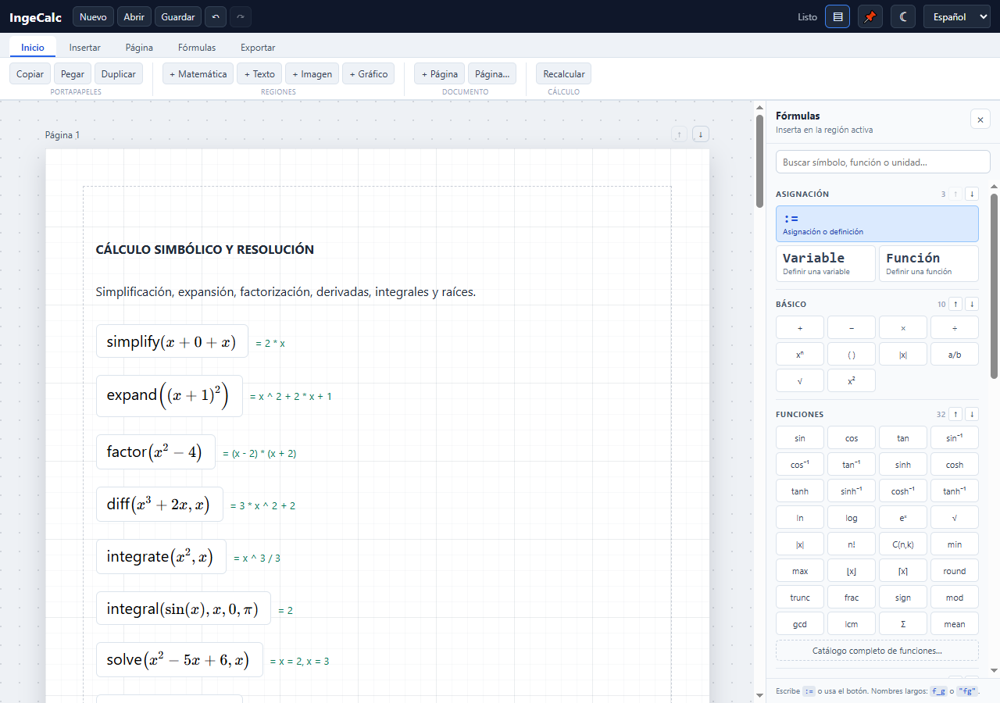
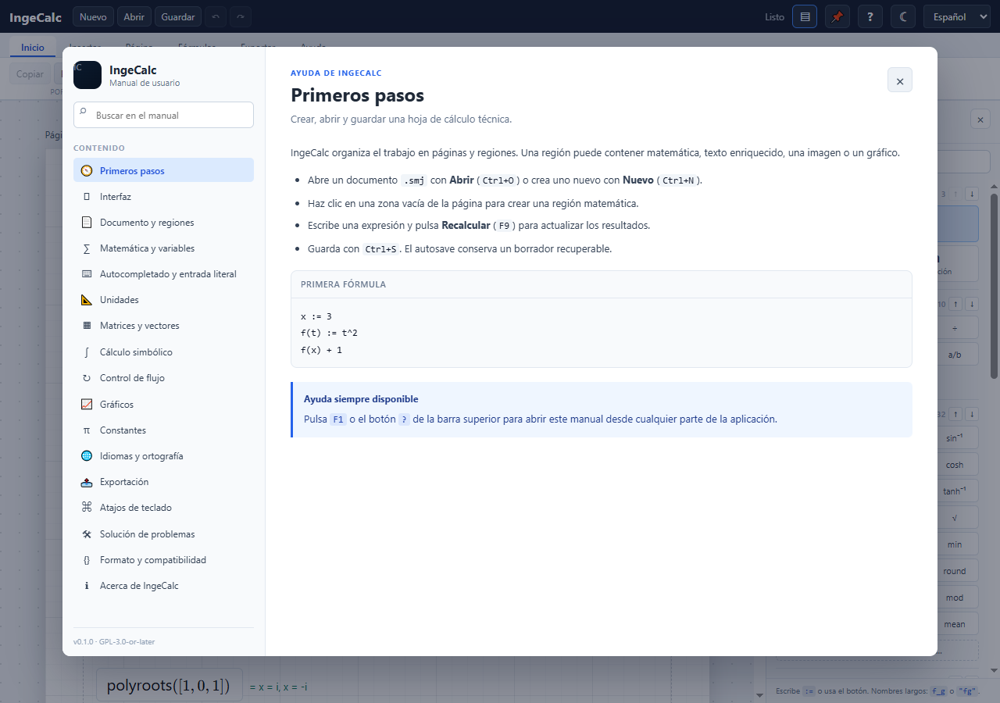

# Manual de IngeCalc

IngeCalc es un editor open source de hojas de cálculo técnico para ingeniería
civil, eléctrica, mecánica, hidráulica y otras disciplinas. Este manual describe
el flujo de trabajo, la sintaxis matemática, las unidades, la exportación y la
resolución de problemas.



> **Ayuda integrada:** pulsa `F1` o el botón `?` de la barra superior para abrir
> el manual navegable dentro de la aplicación. La pestaña **Ayuda** incluye
> accesos directos a primeros pasos, atajos, referencia matemática y solución de
> problemas.



## Contenido

- [Requisitos](#requisitos)
- [Arranque rápido](#arranque-rápido)
- [Interfaz](#interfaz)
- [Documento y regiones](#documento-y-regiones)
- [Matemática](#matemática)
- [Unidades](#unidades)
- [Matrices y vectores](#matrices-y-vectores)
- [Cálculo simbólico](#cálculo-simbólico)
- [Control de flujo](#control-de-flujo)
- [Gráficos](#gráficos)
- [Constantes](#constantes)
- [Exportación](#exportación)
- [Atajos](#atajos)
- [Solución de problemas](#solución-de-problemas)
- [Preguntas frecuentes](#preguntas-frecuentes)
- [Formato y compatibilidad](#formato-y-compatibilidad)
- [Limitaciones actuales](#limitaciones-actuales)

## Requisitos

- Rust stable (edición 2021).
- Node.js 24+ y npm.
- Linux: dependencias de Tauri 2 (WebKitGTK 4.1, librsvg, patchelf).
- Windows: Rust MSVC, Visual Studio Build Tools 2022 y WebView2.
- macOS: Xcode Command Line Tools y Rust; los DMG se generan en CI.
- MiKTeX o TeX Live: opcional, necesario para el PDF vectorial.

### Dependencias Linux (Debian/Ubuntu)

```bash
sudo apt-get install -y \
  libwebkit2gtk-4.1-dev \
  libappindicator3-dev \
  librsvg2-dev \
  patchelf \
  build-essential \
  curl \
  file \
  libssl-dev
```

### Windows

```powershell
winget install Rustlang.Rustup
rustup default stable-x86_64-pc-windows-msvc
npm install
npm run tauri dev
```

Si el perfil de Windows está restringido, se puede redirigir el perfil de
WebView2 y el diario de autosave:

```powershell
$env:INGECALC_WEBVIEW_DATA_DIR = "D:\ruta\escribible\ingecalc-webview2"
$env:INGECALC_DRAFT_DIR = "D:\ruta\escribible\ingecalc-draft"
npm run tauri dev
```

Las variables antiguas `MATHDOC_WEBVIEW_DATA_DIR` y `MATHDOC_DRAFT_DIR` siguen
aceptándose como compatibilidad.

## Arranque rápido

```bash
npm install
npm run tauri dev
```

Solo frontend:

```bash
npm run dev
```

Compilación de escritorio:

```bash
npm run tauri build
```

## Interfaz

La barra superior agrupa los comandos en pestañas:

- **Inicio:** portapapeles, regiones, documento y recálculo.
- **Insertar:** regiones, encabezado/pie, funciones, unidades y constantes.
- **Página:** tamaño, márgenes, unidades de resultado, números, zoom y vista.
- **Fórmulas:** asignación `:=`, panel lateral y catálogos matemáticos.
- **Exportar:** LaTeX, ODT, PDF raster y PDF vectorial.
- **Ayuda:** manual, primeros pasos, atajos, problemas y acerca de IngeCalc.

El **panel lateral de fórmulas** permite buscar e insertar funciones,
operadores, símbolos, unidades y gráficos en la región activa. Se puede mostrar
u ocultar desde la barra superior o desde **Fórmulas**.

La **barra de estado** muestra el estado del documento, el tema, el idioma de la
interfaz y el acceso rápido a la ayuda.

## Documento y regiones

- Cada documento `.smj` contiene páginas de tamaño A4 o Carta.
- Haz clic en una zona vacía para crear una región matemática; arrastra sobre el
  fondo para seleccionar varias regiones.
- `Enter` dentro de una región matemática crea otra región debajo y mueve el
  cursor a ella.
- Las regiones matemáticas y de texto se ajustan a su contenido, respetan los
  márgenes y refluyen hacia abajo o hacia otra página cuando no caben.
- Las cajas vacías se eliminan al perder el foco.
- La barra superior permite mover, fijar, duplicar y eliminar regiones.
- El botón **👁**, junto a **📌**, oculta o muestra las respuestas automáticas en
  verde. Las regiones que terminan en `=` conservan su resultado.
- `Ctrl+clic` añade o quita regiones de la selección; `Ctrl+D` duplica.
- `Ctrl+Z` y `Ctrl+Y` deshacen y rehacen. Un arrastre o redimensionado cuenta
  como una sola operación.

### Páginas

- `+ Página` añade una página al final; las flechas la reordenan.
- **Página → Página…** ajusta tamaño, márgenes, encabezado y pie.
- El token `{page}` se sustituye por el número de página.
- **Página → Opciones** controla la cuadrícula y el ajuste a una rejilla de 20 px.
- La cuadrícula no se imprime.

### Texto enriquecido

- Selecciona una región de texto para mostrar la barra de formato.
- Incluye negrita, cursiva, subrayado, encabezado, listas, color, tamaño,
  fuente, tablas y enlaces.
- El botón **ƒx** inserta matemática inline con KaTeX.
- El corrector ortográfico usa diccionarios Hunspell para español, inglés,
  francés, hindi y árabe. Las marcas no se guardan en el HTML ni se imprimen.

## Matemática

### Variables y funciones

```text
x := 3
f(t) := t^2
f(x) + 1
```

- Las definiciones se evalúan por dependencias, no por orden de aparición.
- Un nombre solo puede definirse una vez.
- No hay ámbitos anidados ni recursión; los ciclos se reportan como error.
- El valor absoluto se puede escribir como `abs(x)` o `|x|`; la paleta inserta
  `|x|`. La parte entera y el techo aceptan `floor(x)`/`⌊x⌋` y `ceil(x)`/`⌈x⌉`.
- Los subíndices de varias letras se conservan como un solo nombre: `p_{y2}`
  se evalúa como `p_y2`.

### Autocompletado

Al escribir el comienzo de una variable, función, constante u operador aparece
un menú agrupado. Si el nombre no existe, se sugiere `nombre :=`; si ya existe,
solo se ofrece para usarlo. Las funciones definidas sugieren primero `f(...) =`.

- `↑`/`↓`: navegar.
- `Tab` o clic: insertar.
- `Enter` sin navegación: cerrar el menú sin autocorregir.
- `Ctrl+Espacio`: abrir el catálogo completo.
- `Esc`: cerrar.

La entrada es literal: no se aplican conversiones automáticas como `Re → ℜ` o
`alpha → α`. Los símbolos se insertan desde la paleta o el autocompletado.

### Unidades

```text
d := 2"m" + 30"cm"
t := 2"s"
v := d/t
T := 20"°C" + 5"K"
```

- Se admiten unidades SI, imperiales y localizadas.
- La suma y la resta convierten a la unidad de la izquierda.
- La multiplicación y la división combinan dimensiones.
- **Página → Unidades…** permite elegir el sistema de resultados, personalizar
  magnitudes o conservar las unidades originales.
- Las unidades propias deben ser lineales:

```text
unit("mi_pulgada") := 2.54 cm
unit("mi_pie") := 12 mi_pulgada
0"cm" + 1"mi_pie"
```

### Matrices y vectores

```text
A := [1,2;3,4]
B := [2,0;1,2]
A*B
det(A)
A^-1
A[2,1]
identity(3)
solve([2,1;1,3],[1;2])
```

La indexación es 1-based. También están disponibles `range`, `matrix`, `resize`,
`reshape`, `flatten`, `size`, `row`, `col`, `augment`, `stack`, `minor`,
`vminor`, `cofactor`, `dot`, `cross`, `norm`, `lu`, `qr`, `rank`, `rref` y
`eigenvalues`.

### Cálculo simbólico

```text
simplify(x + 0 + x)
expand((x+1)^2)
factor(x^2 - 4)
diff(x^3 + 2*x, x)
integrate(x^2, x)
integral(sin(x), x, 0, pi)
solve(x^2 - 5*x + 6, x)
polyroots([1, 0, 1])
```

El motor simbólico cubre simplificación, expansión, factorización, sustitución,
derivadas, primitivas elementales, integrales definidas numéricas, ecuaciones y
raíces. No pretende sustituir a un CAS completo.

### Control de flujo

```text
if(x > 0, 1, 0)
for(i, 1, 10, i^2)
for(v, [1,2,3], v^2)
sum(i, 1, 100, i)
product(i, 1, 5, i)
line(x := 0, while(x < 5, x := x + 1), x)
trace("valor", x^2)
error("mensaje")
```

Los bucles tienen un límite de 100 000 iteraciones.

### Gráficos

Cada serie de una región `plot` puede ser:

- explícita: `sin(x)`;
- paramétrica: `x(t)=cos(t)`, `y(t)=sin(t)`;
- implícita: `x^2+y^2-4`;
- superficie 3D: `z=f(x,y)` con dominios X/Y, rotación y zoom;
- con unidades: `x * 1 m` conserva la unidad en el eje Y.

## Constantes

**Fórmulas → Constantes…** abre el catálogo de constantes físicas y de
materiales. Las constantes propias se guardan en el documento y se evalúan antes
que las regiones.

## Exportación

- **LaTeX:** documento `.tex` con resultados calculados.
- **ODT:** fórmulas como objetos Math embebidos, tablas, imágenes y encabezado/pie.
- **PDF raster:** KaTeX + html2canvas + jsPDF; texto no seleccionable.
- **PDF vectorial:** LaTeX/MiKTeX; requiere un motor externo.
- **PNG/SVG:** gráficos 2D.

El motor LaTeX se busca en este orden:

1. `INGECALC_LATEX_ENGINE` (o `MATHDOC_LATEX_ENGINE` como compatibilidad).
2. `xelatex`, `lualatex` o `pdflatex` en `PATH`.
3. Rutas habituales de MiKTeX en Windows.

## Atajos

| Atajo | Acción |
|---|---|
| `Ctrl+N` | Nuevo documento |
| `Ctrl+O` | Abrir |
| `Ctrl+S` | Guardar |
| `Ctrl+P` | Imprimir |
| `Ctrl+Z` / `Ctrl+Y` | Deshacer / rehacer |
| `Ctrl+D` | Duplicar selección |
| `F9` | Recalcular |
| `Ctrl+=` / `Ctrl+-` / `Ctrl+0` | Zoom |
| `Tab` / `Shift+Tab` | Navegar regiones |

## Solución de problemas

### No aparece el motor LaTeX

Instala MiKTeX o TeX Live y comprueba que `xelatex`, `lualatex` o `pdflatex`
estén en `PATH`. También puedes definir la ruta exacta:

```powershell
$env:INGECALC_LATEX_ENGINE = "C:\ruta\a\xelatex.exe"
```

La variable antigua `MATHDOC_LATEX_ENGINE` sigue aceptándose.

### Una fórmula no evalúa

- Comprueba que todas las variables estén definidas.
- Recuerda que cada nombre admite una sola definición.
- Revisa que las unidades sean compatibles.
- Usa `F9` o **Recalcular** después de cambiar una definición.
- Si el error menciona un símbolo desconocido, crea el nombre con `nombre := valor`.

### Una caja no cabe o se solapa

Las cajas respetan los márgenes y refluyen hacia abajo. Si una caja fijada bloquea
el movimiento, se traslada a la página siguiente. Puedes liberar posiciones con
el botón de fijar o desde **Página → Opciones**.

### No veo el borrador anterior

El identificador de la aplicación cambió a `org.ingecalc.app`, por lo que
WebView2 usa un directorio de datos nuevo. Los borradores de la etapa anterior
no se migran automáticamente. Puedes recuperar el documento desde su archivo
`.smj` original.

### El PDF raster no permite seleccionar texto

El PDF raster es una imagen de alta calidad. Para texto vectorial y seleccionable,
usa **PDF LaTeX** y configura un motor LaTeX.

### El autocompletado no inserta

Navega con `↑`/`↓` y pulsa `Tab`, o haz clic en la sugerencia. `Enter` sin
navegación solo cierra el menú, sin autocorregir el texto.

### El corrector ortográfico no muestra sugerencias

Comprueba el idioma del documento en **Página → Página…** o en la barra de la
región de texto. El chino simplificado está disponible en la interfaz, pero no
usa Hunspell.

### IngeCalc se cierra al arrancar en Windows

Si el Visor de eventos muestra un fallo en `NahimicOSD.dll`, el problema proviene
del overlay de audio Nahimic / Alienware Sound Center, no de IngeCalc.

En equipos con Nahimic, IngeCalc solicita UAC, detiene temporalmente
`NahimicService`, abre la aplicación y lo reactiva después. Esto evita que la DLL
se inyecte en el proceso durante el arranque.

Si cancelas el UAC, la aplicación no se abrirá. Para evitar el aviso en cada
arranque:

- desactiva el **Sound Tracker / overlay** de Nahimic; o
- detén `NahimicService` antes de abrir IngeCalc; o
- renombra `NahimicOSD.dll` a `.bak` con permisos de administrador.

La última opción solo desactiva el overlay gráfico; el audio principal de Nahimic
sigue funcionando. Una actualización de Dell/Nahimic puede restaurar el archivo.

## Preguntas frecuentes

### ¿IngeCalc puede redefinir una variable?

No. Cada nombre tiene una sola definición para evitar dependencias ambiguas. Si
necesitas otro valor, usa un nombre distinto.

### ¿Puedo usar varias unidades en la misma fórmula?

Sí. Las operaciones convierten y simplifican dimensiones. El sistema de resultados
se elige en **Página → Unidades…**.

### ¿Los documentos antiguos siguen funcionando?

Sí. El cargador acepta `mathdoc-json` y migra el documento a `ingecalc-json` al
guardarlo.

### ¿Dónde se guarda el borrador?

En el directorio de datos de la aplicación. En entornos restringidos puedes usar
`INGECALC_DRAFT_DIR`.

### ¿Cómo abro la ayuda?

Pulsa `F1`, el botón `?` de la barra superior o la pestaña **Ayuda**.

### ¿Puedo exportar sin instalar LaTeX?

Sí. El PDF raster y la exportación a LaTeX/ODT funcionan sin un motor LaTeX. Para
compilar el PDF vectorial necesitas MiKTeX o TeX Live.

## Formato y compatibilidad

Los documentos usan JSON con extensión `.smj`:

```json
{
  "format": "ingecalc-json",
  "version": 1
}
```

IngeCalc escribe `ingecalc-json`. El cargador también acepta documentos antiguos
con `mathdoc-json` y los migra al formato actual al guardarlos.

## Limitaciones actuales

- Una sola definición por nombre; sin ámbitos anidados ni recursión.
- Matrices numéricas `f64`; no admiten cantidades heterogéneas.
- Unidades propias lineales, sin offsets.
- Racionales con enteros de 64 bits; complejos con funciones básicas.
- El motor simbólico es acotado y no cubre todas las transformaciones de un CAS.
- En LaTeX/ODT las regiones conservan contenido y orden, pero no posiciones
  absolutas.
- La matemática inline en ODT se exporta como texto ASCII por compatibilidad.
- El PDF raster no tiene texto seleccionable; para texto vectorial usa LaTeX.
- El diálogo de impresión depende de WebView2/WebKitGTK.
- El desbordamiento de texto mueve la caja completa; el corte por párrafos con
  continuación en la página siguiente sigue pendiente.
